# Flow 1 — Authentication & Session

| | |
|---|---|
| **Status** | Approved 2026-11-03, implementation in progress |
| **Platforms** | API (NestJS) · Web (Next.js) · Mobile (Expo) |
| **Last updated** | 2026-11-03 |

**Legend used throughout this document**

- ✅ **Implemented**: exists in the code today (verified against the source)
- 🟡 **Proposed**: design suggestion, **not approved yet**, not built
- ❓ **Open question**: business decision, now answered (see [section 7](#7-decisions))

---

## Contents

1. [Business analysis](#1-business-analysis)
2. [User journey](#2-user-journey)
3. [Technical architecture](#3-technical-architecture)
4. [Flow diagrams](#4-flow-diagrams)
5. [Error handling](#5-error-handling)
6. [Issues found in the current implementation](#6-issues-found-in-the-current-implementation)
7. [Decisions](#7-decisions)
8. [Implementation plan](#8-implementation-plan-after-approval)

---

## 1. Business analysis

### 1.1 Objective

Let a runner create an account, prove they own their email address, sign in on web or mobile, **stay signed in** between visits, and sign out. Every later flow (profile, event registration, payments, results) depends on knowing who the user is.

### 1.2 Sub-flows

| ID | Sub-flow | Status |
|---|---|---|
| 1.1 | Sign up | ✅ API · ✅ Web · ✅ Mobile |
| 1.2 | Email verification and resend | ✅ API · ✅ Web · ❌ Mobile (link always opens the web app) |
| 1.3 | Sign in (email or username) | ✅ API · ✅ Web · ✅ Mobile |
| 1.4 | Session persistence and restore | ❌ Not built: tokens are thrown away after sign-in |
| 1.5 | Token refresh (rotation and reuse detection) | ✅ API · ❌ Web · ❌ Mobile |
| 1.6 | Sign out | ✅ API · ❌ Web · ❌ Mobile |
| 1.7 | Current-user lookup (`/auth/me`) | ✅ API · 🟡 Web · 🟡 Mobile |
| 1.8 | Forgot / reset password | 🟡 Proposed ❓ |

### 1.3 Actors and roles

| Actor | Description |
|---|---|
| **Visitor** | Not signed in. Can browse events and sign up or sign in. |
| **Runner** (`RUNNER`) | Default role given at sign-up. |
| **Admin** (`ADMIN`) / **Super admin** (`SUPER_ADMIN`) | Exist in the schema. They sign in through the same flow; their permissions belong to Flow 8. No admin accounts can be created through sign-up. |
| **API** | Issues and checks tokens. |
| **Mail service** | Sends verification (and later reset) emails. ✅ Currently only **logs** messages; no provider is connected. |

### 1.4 Preconditions

- The API is reachable and PostgreSQL is running.
- To sign in, the user must already have an account (for sign-in, a **verified** email).

### 1.5 Expected outcome

- A valid account exists with a unique email and username (and a unique phone if one was given).
- The email address is verified.
- The client holds a session that survives an app restart or browser reload, and renews itself silently until the user signs out or the refresh token expires.

### 1.6 Business rules

| # | Rule | Status |
|---|---|---|
| BR-1 | Full name: 2–100 characters after trimming. | ✅ |
| BR-2 | Email: valid format, max 254 chars, stored **lowercase**, unique. | ✅ |
| BR-3 | Username: 3–30 chars, starts with a letter, only `a–z 0–9 . _`, stored lowercase, unique. No `@`, so sign-in can tell a username from an email. | ✅ |
| BR-4 | Phone: optional at sign-up. Spaces, dashes and brackets are removed; then 7–15 digits with an optional leading `+`; unique. Required before registering for an event (enforced in Flow 4). | ✅ (sign-up part) |
| BR-5 | Password: 8–72 chars, with at least one uppercase letter, one digit and one special character. Confirmation must match (checked on the client only). | ✅ |
| BR-6 | Every new account gets role `RUNNER`, `isActive = true`, the chosen locale (`en`/`ar`) and an empty runner profile. | ✅ |
| BR-7 | After sign-up the runner is **signed in immediately** and a verification email is sent. | ✅ (tokens issued, not stored by clients yet). Decided in Q1 |
| BR-8 | Verification link: random one-time token, **valid 24 h**. Using it marks every outstanding link for that user as used. | ✅ |
| BR-9 | Resend verification: silently ignored if the email is unknown, already verified or inactive, or if a link was sent less than **60 s** ago. Always returns success. | ✅ |
| BR-10 | Sign-in accepts email **or** username plus password. | ✅ |
| BR-11 | Unknown user, wrong password and disabled account all get the **same** "Invalid credentials" error. Response time is evened out with a dummy hash so it doesn't reveal which accounts exist. | ✅ |
| BR-12 | A correct password on an **unverified** account is refused with `EMAIL_NOT_VERIFIED`. The email is returned so the client can offer "resend". | ✅ |
| BR-13 | Access token: JWT `{ sub, role }`, lifetime `JWT_ACCESS_TTL` (default **15 min**). | ✅ |
| BR-14 | Refresh token: random value, only its SHA-256 hash is stored, lifetime **30 days**. Each refresh revokes it and issues a new pair (rotation). | ✅ |
| BR-15 | If an already-revoked refresh token is used again, it's treated as theft: **all** of that user's sessions are revoked. | ✅ |
| BR-16 | Sign-out revokes the presented refresh token. Other devices stay signed in. | ✅ |
| BR-17 | All API routes need a valid access token unless marked `@Public()`. Routes can also be limited to roles with `@Roles()`. | ✅ |
| BR-18 | Mobile keeps the refresh token in the device's secure storage; web keeps tokens in httpOnly cookies. Tokens are never in `localStorage`. | 🟡 |
| BR-19 | Rate limits: 5 failed sign-ins per identifier per 2 minutes and 20 per IP per minute; sign-up, resend and forgot password 5 per IP per hour. | 🟡 (Q6) |
| BR-20 | Password reset: one-time link valid 1 hour; a successful reset signs the user out on every device. | 🟡 (Q2) |
| BR-21 | An unverified runner can browse and edit their profile but can't register for an event or pay until verified (enforced in Flow 4). | 🟡 (Q1) |

---

## 2. User journey

### 2.1 Sign up ✅

| Step | User | System |
|---|---|---|
| 1 | Taps **Sign in** in the header, then **Create account** (web `/[locale]/register`, mobile `/register`). | Shows the form with a live password checklist. |
| 2 | Fills in name, email, username, optional phone, password and confirmation; submits. | Checks the form on the client (`validateRegisterForm`). If invalid, marks the fields and shows "fix errors". |
| 3 | — | `POST /auth/register`. The API checks the fields again and that email, username and phone aren't taken. |
| 4a ✔ | — | Creates the user and profile, emails a verification link, returns `{ accessToken, refreshToken }`. |
| 5a | — | **Web:** saves the email in `sessionStorage` and goes to home, which shows a one-time "confirm your email" notice. **Mobile:** shows an alert and goes to home. Tokens are **ignored** (see issue I-1). |
| 4b ✖ | — | `409`: email, username or phone already taken. The message is shown under the matching field. |
| 4c ✖ | — | `400`: server validation failed. Network error: generic message. |

### 2.2 Email verification ✅

| Step | User | System |
|---|---|---|
| 1 | Opens the email and taps the link `WEB_URL/{locale}/verify-email?token=…`. | Web page calls `POST /auth/verify-email` once. |
| 2a ✔ | — | `204`: "Email confirmed", with a **Sign in** button. |
| 2b ✖ | — | `400`: "link invalid or expired", with a **Sign in** button (from there the user can resend). |
| 2c ✖ | — | No token in the URL: "missing link" message. |

The link always opens the **web** app, even for runners who signed up on mobile (❓ Q3).

### 2.3 Sign in ✅ (session part 🟡)

| Step | User | System |
|---|---|---|
| 1 | Enters email or username and password. | Checks that neither field is empty. |
| 2 | — | `POST /auth/login`. |
| 3a ✔ | — | `200` with tokens. **Today:** shows a "signed in" message and throws the tokens away. 🟡 **Proposed:** stores the session, loads the user (`GET /auth/me`) and goes back to the previous screen or home. |
| 3b ✖ | — | `401`: "Invalid credentials". |
| 3c ⚠ | — | `403 EMAIL_NOT_VERIFIED`: "Please verify your email" plus a **Resend link** button that calls `POST /auth/resend-verification` and always reports success. |

### 2.4 Session restore, refresh and sign out 🟡

| Situation | Proposed behaviour |
|---|---|
| App launch or page load | If a refresh token is stored, refresh it to get a new access token, then load `/auth/me`. On failure, clear the stored tokens and continue as a visitor. |
| Access token expires during use | The shared client gets `401`, refreshes **once** (concurrent requests wait for the same refresh), then retries the request. If the refresh fails, the user is signed out and sent to sign-in. |
| Refresh token reused (theft) | The API revokes every session for the user. The client gets `401` and signs out. |
| User taps **Sign out** | `POST /auth/logout` with the refresh token, then local tokens are cleared and the user goes home. Local tokens are cleared even if the network call fails. |
| Header | Shows the user's name and a menu (sign out) when signed in, and **Sign in** otherwise. |

### 2.5 Forgot / reset password 🟡 ❓ Q2

| Step | User | System |
|---|---|---|
| 1 | Taps **Forgot password?** on the sign-in screen and enters their email. | `POST /auth/forgot-password`. Always returns success with "If the account exists, we sent a link". |
| 2 | Opens the email link `WEB_URL/{locale}/reset-password?token=…`. | Shows the new-password form with the same checklist as sign-up. |
| 3 | Submits a new password. | `POST /auth/reset-password`. On success: password replaced, link used, **all refresh tokens revoked**, user sent to sign-in. On failure: "link invalid or expired". |

---

## 3. Technical architecture

### 3.1 Components overview

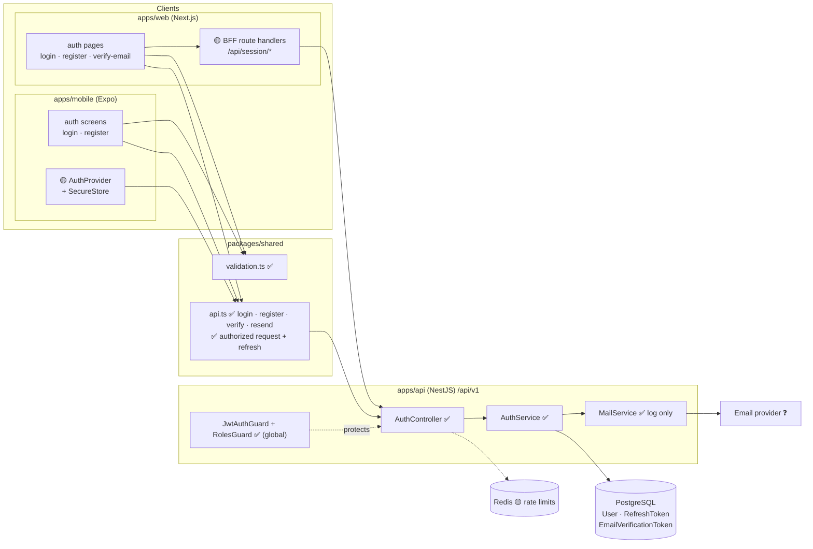

### 3.2 Screens and navigation

| Screen | Web route | Mobile route | Module | Status |
|---|---|---|---|---|
| Sign in | `/[locale]/login` | `/login` | `modules/auth` | ✅ |
| Create account | `/[locale]/register` | `/register` | `modules/auth` | ✅ |
| Verify email | `/[locale]/verify-email?token=` | — ❓ Q3 | `modules/auth` | ✅ web |
| Forgot password | `/[locale]/forgot-password` | `/forgot-password` | `modules/auth` | 🟡 |
| Reset password | `/[locale]/reset-password?token=` | — (web link) | `modules/auth` | 🟡 |
| Header user menu | `common/Header` | `common/AppHeader` | `modules/common` | 🟡 |

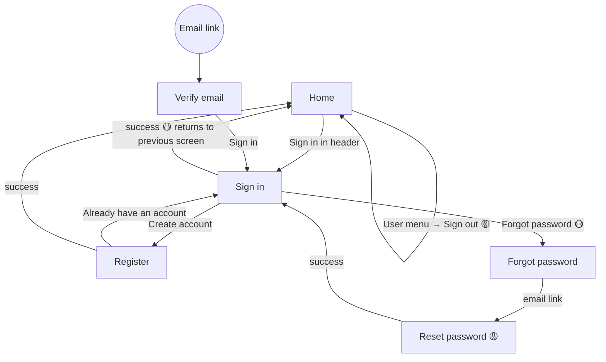

### 3.3 API endpoints

All paths start with `/api/v1`. Errors use NestJS's standard shape `{ statusCode, message, error? }`, and add `code` when the client needs a machine-readable reason.

| Method & path | Access | Request body | Success | Errors | Status |
|---|---|---|---|---|---|
| `POST /auth/register` | Public | `{ fullName, email, username, phone?, password, locale? }` | `201 { accessToken, refreshToken }` | `400` validation · `409` taken | ✅ |
| `POST /auth/login` | Public | `{ identifier, password }` | `200 { accessToken, refreshToken }` | `400` · `401` · `403 EMAIL_NOT_VERIFIED {email}` | ✅ |
| `POST /auth/verify-email` | Public | `{ token }` | `204` | `400` invalid/expired | ✅ |
| `POST /auth/resend-verification` | Public | `{ email }` | `204` (always) | `400` bad email format | ✅ |
| `POST /auth/refresh` | Public | `{ refreshToken }` | `200 { accessToken, refreshToken }` | `401` | ✅ |
| `POST /auth/logout` | Public | `{ refreshToken }` | `204` (always) | `400` | ✅ |
| `GET /auth/me` | Bearer | — | `200 { id, fullName, email, username, phone, locale, role, emailVerified }` | `401` | ✅ |
| `POST /auth/forgot-password` | Public | `{ email }` | `204` (always) | `400` | 🟡 ❓ Q2 |
| `POST /auth/reset-password` | Public | `{ token, password }` | `204` | `400` invalid/expired/weak | 🟡 ❓ Q2 |

### 3.4 Data model

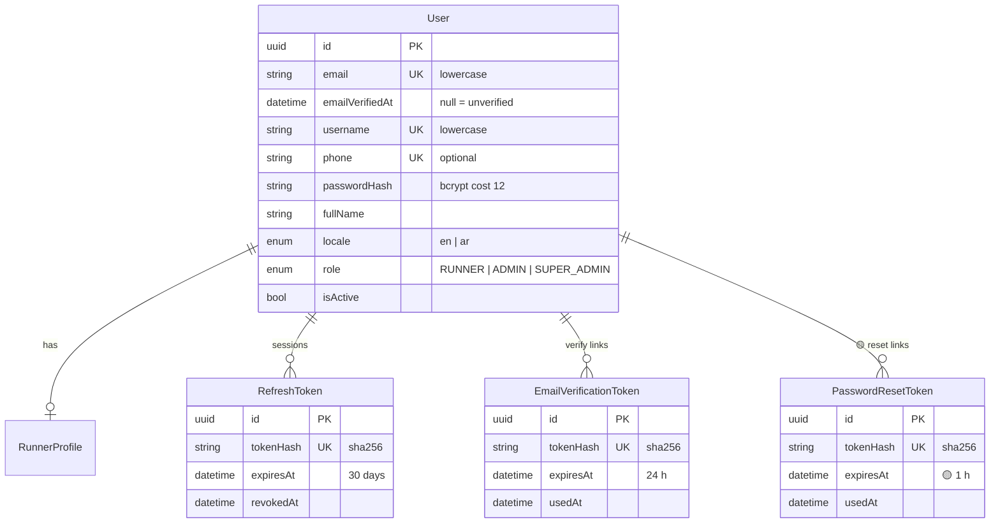

All tables except `PasswordResetToken` ✅ exist in `apps/api/prisma/schema.prisma`. `PasswordResetToken` 🟡 would copy the shape of `EmailVerificationToken`.

### 3.5 Modules and files

| Layer | Path | Responsibility |
|---|---|---|
| API | `apps/api/src/modules/auth/` | Controller, service, DTOs, JWT strategy |
| API | `apps/api/src/common/` | `@Public`, `@Roles`, `@CurrentUser`, global guards |
| API | `apps/api/src/mail/` | `MailService.send()`, swap in a provider here |
| Shared | `packages/shared/src/api.ts` | Typed API calls, `ApiError` |
| Shared | `packages/shared/src/validation.ts` | Sign-up form rules, password checklist |
| Web | `apps/web/src/modules/auth/` | Pages, forms, dictionaries |
| Mobile | `apps/mobile/src/modules/auth/` | Screens, `FormField`, `PasswordChecklist`, messages |

### 3.6 Session & state management 🟡

**Mobile**

- `modules/auth/session/AuthProvider.tsx` wraps the root `_layout.tsx` (inside `LanguageProvider`).
- State: `status: 'loading' | 'anonymous' | 'authenticated'` and `user: Me | null`.
- The **access token** is kept only in memory. The **refresh token** is kept in `expo-secure-store` (Keychain on iOS, Keystore on Android). Check the API against the Expo SDK 58 docs before implementing.
- `useAuth()` returns `{ user, status, signIn, signUp, signOut }`.
- While `status === 'loading'`, the splash screen stays up, so the header doesn't flash "Sign in".

**Web: Backend-for-Frontend (BFF) pattern**, recommended (see [ADR-001](../../decisions/ARCHITECTURE_DECISIONS.md#adr-001-session-storage-on-web-and-mobile))

- Next.js route handlers under `/api/session/*` (`login`, `register`, `refresh`, `logout`, `me`) call the Nest API from the server and set **httpOnly, Secure, SameSite=Lax** cookies on the web's own domain. Browser JavaScript never sees the tokens.
- Server components read the cookie to render the header and to protect pages server-side.
- The existing middleware already skips `/api`, so locale redirects won't touch these routes.

**Shared client** (`packages/shared/src/api.ts`) ✅

- Add a generic `request(method, path, { body, accessToken })`.
- Add `createAuthedClient({ getAccessToken, refresh, onSignedOut })`. It retries once after `401`, and concurrent calls share one refresh.
- Add `refresh`, `logout`, `getMe` and the matching types.

### 3.7 Session lifecycle

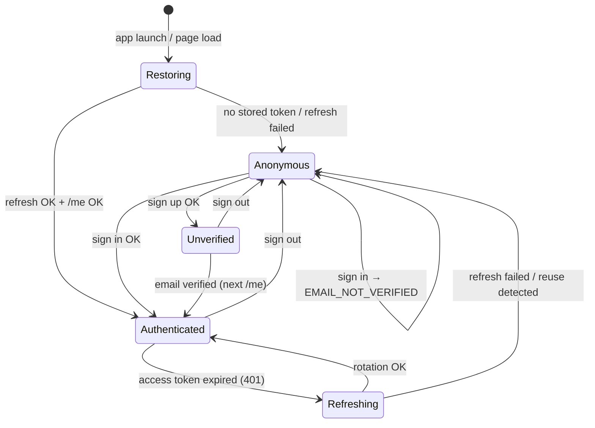

An **Unverified** user can browse and edit their profile, but can't register for events or pay (BR-21).

### 3.8 Security measures

| Threat | Measure | Status |
|---|---|---|
| Database leak exposes sessions | Only SHA-256 hashes of refresh, verification and reset tokens are stored | ✅ |
| Password cracking | bcrypt cost 12, max 72 bytes | ✅ |
| Account enumeration via sign-in | Same error message and same timing (dummy hash) | ✅ |
| Account enumeration via resend / forgot | Always `204` | ✅ / 🟡 |
| Account enumeration via sign-up | `409` names the taken field. Accepted for a usable sign-up form ❓ Q7 | ✅ (trade-off) |
| Stolen refresh token | Rotation plus reuse detection revokes all sessions | ✅ |
| XSS stealing tokens on web | httpOnly cookies through the BFF | 🟡 |
| CSRF on web | SameSite=Lax cookies; BFF accepts only POST with a JSON content type | 🟡 |
| Brute force / spam | Redis-backed rate limits per IP and per identifier | 🟡 ❓ Q6 |
| Unexpected fields in requests | Global `ValidationPipe` with `whitelist` and `forbidNonWhitelisted` | ✅ |

---

## 4. Flow diagrams

### 4.1 Sign up ✅

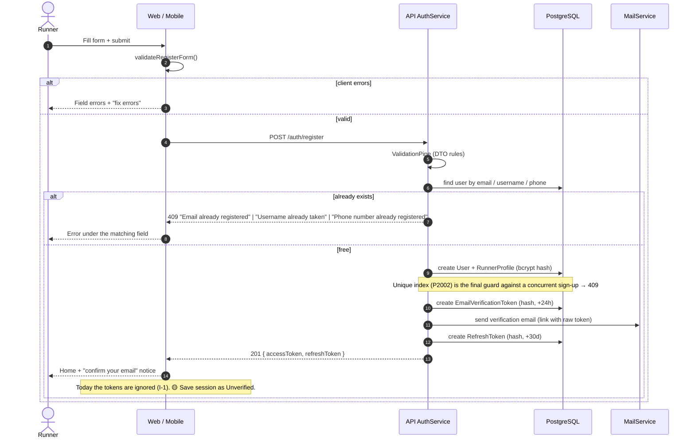

### 4.2 Email verification & resend ✅

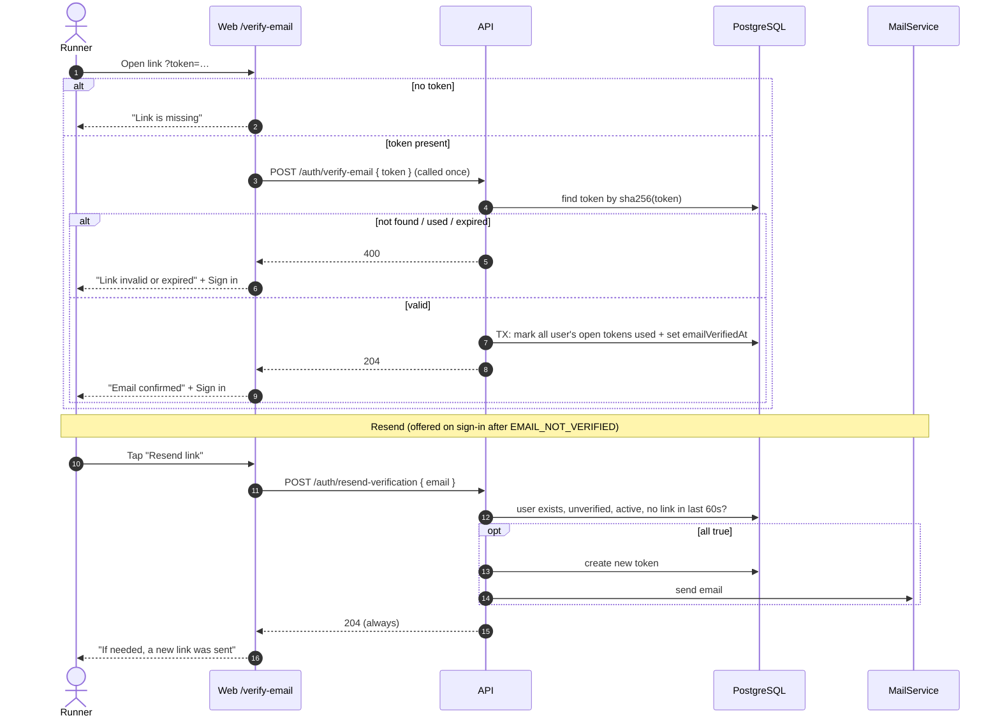

### 4.3 Sign in ✅ (+ 🟡 session storage)

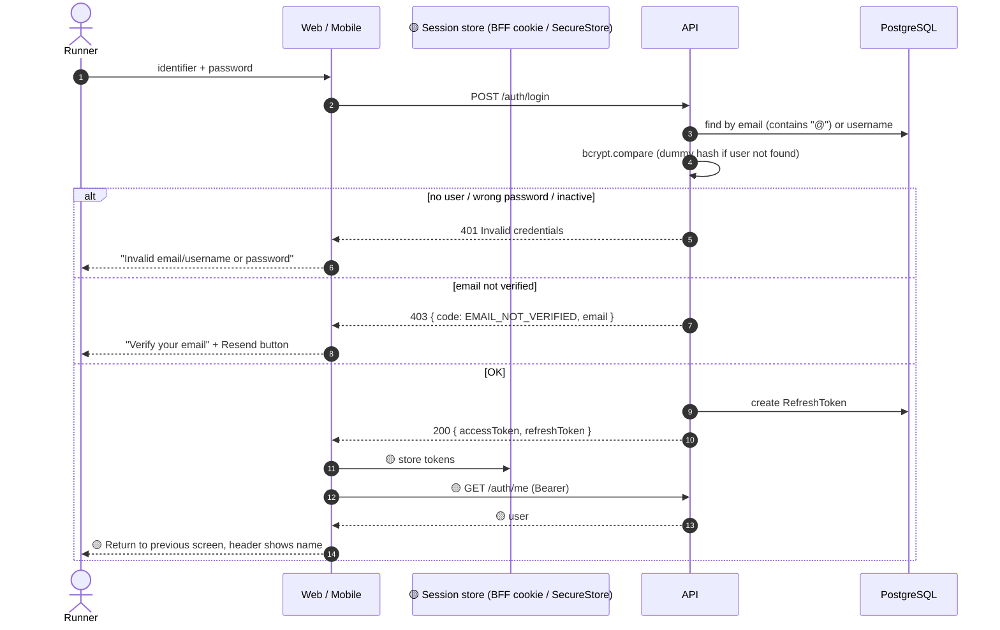

### 4.4 Session restore & silent refresh 🟡 (API side ✅)

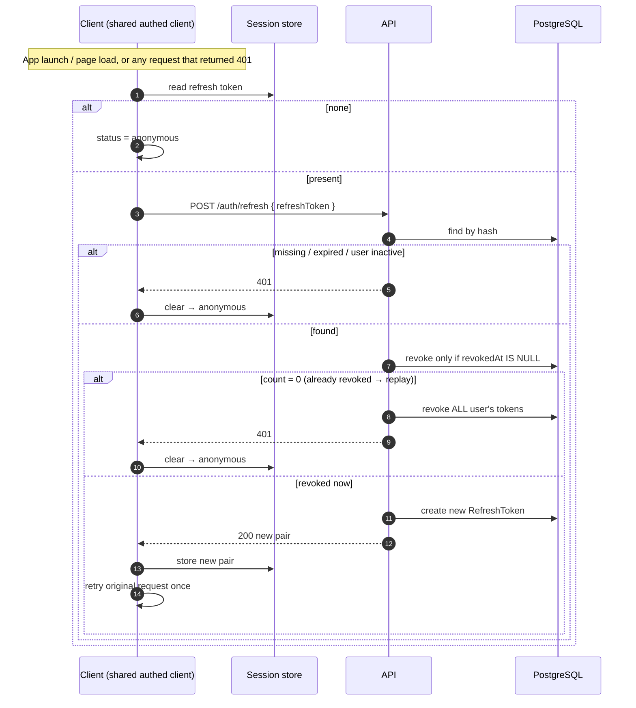

### 4.5 Sign out 🟡 (API side ✅)

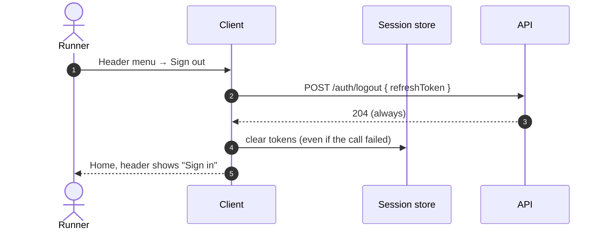

### 4.6 Forgot / reset password 🟡 ❓ Q2

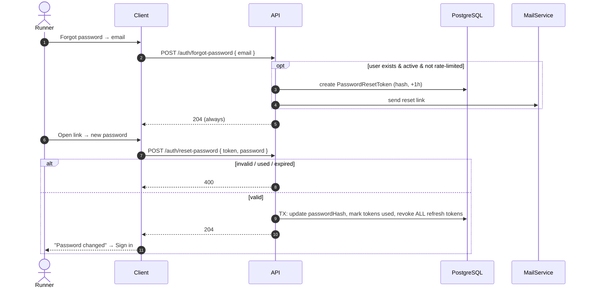

### 4.7 Decision flow: is the user allowed in?

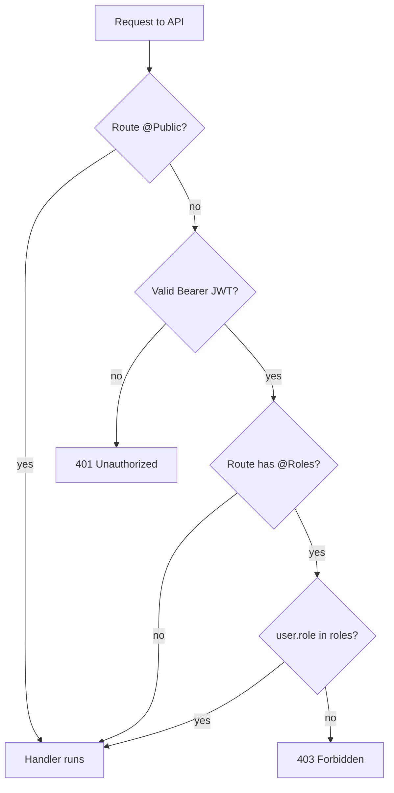

The access token stays valid until it expires, even if the account is disabled in the meantime; the next refresh will fail. With a 15-minute access token this delay is accepted (see I-6).

---

## 5. Error handling

### 5.1 Client error mapping

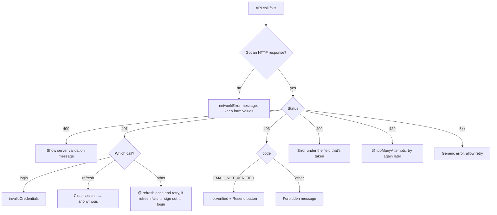

### 5.2 Error catalogue

| Case | HTTP | `code` | User message key (web `auth/i18n.ts`, mobile `auth/messages.ts`) |
|---|---|---|---|
| Missing fields (client) | — | — | `required` / `fieldErrors.*` |
| Server validation | 400 | — | API message (joined) |
| Email / username / phone taken | 409 | ✅ `EMAIL_TAKEN` · `USERNAME_TAKEN` · `PHONE_TAKEN` | `fieldErrors.emailTaken` etc. |
| Wrong credentials | 401 | — | `invalidCredentials` |
| Email not verified | 403 | `EMAIL_NOT_VERIFIED` | `notVerified` + `resend` |
| Verification link bad | 400 | — | `verify.failed` |
| Refresh failed | 401 | — | silent sign-out |
| Rate limited | 429 | 🟡 | 🟡 `tooManyAttempts` |
| No network | — | — | `networkError` |

---

## 6. Issues found in the current implementation

| ID | Issue | Impact | Suggested fix |
|---|---|---|---|
| I-1 | Web and mobile ignore the tokens returned by register and login. | Users never actually stay signed in. | Sub-flow 1.4 (this flow). |
| I-2 | Register signs the user in while their email is unverified, but login refuses unverified users, and `refresh` doesn't check verification. An unverified user can stay signed in for as long as they keep refreshing. | Rules contradict each other. | Depends on ❓ Q1. |
| I-3 | Clients find the field behind a `409` by matching English words in the message (`/email/i`). | Breaks if the message changes or is translated. | ✅ Fixed: API returns `code` (`EMAIL_TAKEN` …) and web and mobile map on `code`. |
| I-4 | Validation patterns are written twice (`auth.dto.ts` and `shared/validation.ts`). | They can drift apart. | Deferred: `@runner/shared` ships TypeScript source only, which the CommonJS API build can't load. Needs a build step for the shared package first. |
| I-5 | No rate limiting on login, register or resend. | Brute force, email spam. | Redis-backed throttling (Redis is already in docker-compose). |
| I-6 | A disabled account keeps its current access token until it expires (≤ 15 min). | Short delay before a block takes effect. | Accept, or check `isActive` in `JwtStrategy.validate` (costs one DB query per request). |
| I-7 | No mobile verify-email screen; links always open the web app. | Mobile runners land in a browser. | ❓ Q3. |
| I-8 | `MailService` only logs. | No real emails sent. | ❓ Q8, choose a provider. |
| I-9 | No Prisma migrations are committed. | Schema changes aren't reproducible. | ✅ Fixed: baseline `prisma/migrations/0_init` generated from the schema. |
| I-10 | No automated tests for auth. | Regressions go unnoticed. | Unit tests for `AuthService` and e2e tests for the endpoints. |

---

## 7. Decisions

All questions were answered on 2026-11-03. Q8 is deferred and doesn't block this flow: emails keep going to the log until a provider is chosen.

| # | Question | Decision |
|---|---|---|
| **Q1** | After sign-up, should an **unverified** runner be signed in? What can they do before verifying? | Keep automatic sign-in. Allow browsing and editing the profile. **Block event registration and payment** until verified (enforced in Flow 4). `refresh` keeps working for unverified users, and `/me` returns `emailVerified` so the client can show a reminder banner. |
| **Q2** | Include **forgot / reset password** in Flow 1? | Yes, with a 1-hour link that signs the user out everywhere. |
| **Q3** | Should verification and reset links open the **mobile app** when installed? | Later, once the production domain exists. For now links open the web page. |
| **Q4** | Access token 15 min, refresh token 30 days: OK? Do we need "remember me"? | Keep 15 min / 30 days, no "remember me". |
| **Q5** | Should **change password** and **sign out of all devices** be part of this flow or of Runner Profile? | Runner Profile (Flow 2). |
| **Q6** | Rate-limit thresholds? | Login: 5 failures per identifier per **2 minutes**, and 20 per IP per minute. Register, resend and forgot: 5 per IP per hour. |
| **Q7** | Is it acceptable that sign-up reveals "email already registered"? | Yes. It's common practice and sign-in already hides it. |
| **Q8** | Which **email provider** and sender address? | Deferred, to be decided later. Only `MailService` will change. |
| **Q9** | Should the web app use the **BFF cookie** approach ([ADR-001](../../decisions/ARCHITECTURE_DECISIONS.md#adr-001-session-storage-on-web-and-mobile))? | Yes. |

---

## 8. Implementation plan (after approval)

Ordered so that each step can be tested on its own.

1. ✅ **API:** baseline Prisma migration (I-9). Add `GET /auth/me`. Add `code` to `409` errors (I-3). (I-4 deferred, see section 6.)
2. ✅ **Shared:** generic `request()`, `refresh`, `logout`, `getMe`, and the authorized client (`createAuthedClient`) with single-flight refresh.
3. **Mobile:** add `expo-secure-store` with `npx expo install`. Build `AuthProvider` and `useAuth`. Connect login and register. Header user menu and sign out.
4. **Web:** BFF route handlers with cookies. Server-side `getSession()`. Connect login and register. Header user menu and sign out.
5. **API:** rate limiting (Q6).
6. **Forgot / reset password** across API, web and mobile.
7. **Tests:** `AuthService` unit tests and endpoint e2e tests.
8. Run lint and typecheck on all workspaces, then update this document from "Proposed" to "Implemented".
